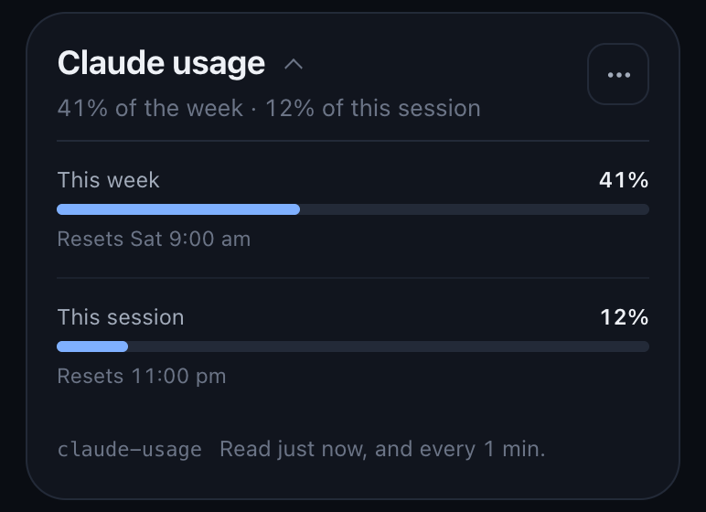

# Project Shire

[](https://github.com/abigailzeke/project-shire/actions/workflows/tests.yml)

**An observability platform for always-on laptops and power users. If you can script it, Shire can watch it.**

Project Shire watches a Mac that runs unattended and shows its state on a mobile-first status page. Everything on that page is a plugin, and a new one takes a single YAML file, or a script in any language. There is no front-end code to write and nothing in Shire to change.

> **Status:** v0.2.0. macOS only.

<p align="center">
  
  
  
</p>

<p align="center"><sub>The page at phone size, with sample data.</sub></p>

## Extend it with one file

Create `~/.config/project-shire/plugins/my-site/plugin.yaml`:

```yaml
name: My site
check: website
url: https://example.com
every: 1m
```

Within seconds, and without a restart, the page has a new widget that shows whether the site responds and how fast. Five checks work this way, with no code at all:

| Check | Reports | Requires |
|---|---|---|
| `website` | whether a URL responds, and the response time | `url` |
| `program` | whether a matching process is running | `match` |
| `port` | whether a port accepts connections | `port` |
| `file` | the contents of a JSON or text file | `path` |
| `folder` | the file count and the most recent changes | `path` |

## Extend it with a script

For anything else, a plugin runs an executable in any language, kept beside its `plugin.yaml`. This one reports Claude usage limits:

```yaml
name: Claude usage
check: script
script: collect.py
every: 1m
display: gauge
```

The script's only job is to print JSON in Shire's standard format:

```json
{
  "summary": "41% of the week · 12% of this session",
  "items": [
    {"key": "week", "name": "This week", "value": 41, "unit": "%",
     "state": "good", "note": "Resets Sat 9:00 am"},
    {"key": "session", "name": "This session", "value": 12, "unit": "%",
     "note": "Resets 11:00 pm"}
  ]
}
```

Shire validates the result, stores it, and renders it:

<p align="center">
  
</p>

Each item requires a `name` and a `key` that is unique and never changes. `value`, `unit`, `state` and `note` are optional. A Python script runs with Shire's own interpreter and can use its helper: `from shire import script`, then `script.done(items)`. A script in another language must be executable (`chmod +x`).

## What every plugin gets

A plugin only reports. The page does the rest, for a plugin of any kind:

- **A widget,** shown as a list, numbers, gauges or a table, chosen with `display`.
- **Status.** An item's `state` is `good`, `warn` or `bad`. A watched item that turns `warn` or `bad`, or goes missing, is raised in the status summary at the top of the page.
- **History.** Items named in `history` keep 24 hours of readings.
- **Control from the page.** Any plugin or item can be renamed, hidden, watched, grouped or switched off, from a phone.
- **Clear errors.** Output that does not match the format never reaches the page, and the page states the reason in plain words.

The [baseline](docs/v0.2-baseline.md#the-standard-format) lists every field of the format, and [every setting](docs/v0.2-baseline.md#plugins) of `plugin.yaml`.

## Built on its own plugins

The eight plugins included with Shire use the same format and the same layout as any other plugin, so they double as worked examples in [`plugins/`](plugins).

| Plugin | Reports |
|---|---|
| Mac health | sleep state, battery, temperature, memory, processor, storage, network, heaviest processes |
| Running apps | open applications, background applications and third-party helpers |
| Running scripts | scripts and interpreters running outside any application |
| Background services | launchd jobs and crontab entries, running or scheduled |
| Docker | Compose projects and the state of each container |
| Claude Code | sessions, Remote Control, connectivity to Anthropic, scheduled jobs |
| What Claude can reach | MCP servers and connectors, and whether each responds |
| Obsidian | note count and recent changes in a vault; disabled until a vault is configured |

Each can be switched off from the page. To change one, create a directory of the same name in the user directory, with a `plugin.yaml` that contains only the settings to change. For example, `plugins/core-obsidian/plugin.yaml`:

```yaml
path: ~/path/to/vault
enabled: true
```

Do not edit the installed copy of a plugin, because an update replaces it.

## Installation

Shire requires macOS. Claude Code and Tailscale are optional.

```
brew install abigailzeke/tap/shire
shire start
shire link
```

`shire link` prints the access URL. Open it once on each device, and a cookie keeps the device signed in for one year. On a phone, add the page to the home screen to open it like an app.

To install from source instead, with Python 3.11 or later and Node.js 20.19 or later:

```
git clone https://github.com/abigailzeke/project-shire
cd project-shire
python3 -m venv .venv
.venv/bin/pip install -e .
(cd web && npm ci && npm run build)
```

The command is then `.venv/bin/shire`.

| Command | Description |
|---|---|
| `shire start` | Registers Shire with launchd, which keeps it running and restarts it at login. |
| `shire stop` | Stops Shire and removes it from launchd. |
| `shire link` | Prints the access URL, which contains the key. |
| `shire run` | Runs Shire in the foreground. |
| `shire run --once` | Runs every enabled plugin once and prints the result of each. |

`start` and `run` accept `--host` and `--port`. The defaults are all network interfaces and port 5190.

## Architecture

```
┌───────────────────────────┐
│ browser: the status page  │
└──────┬─────────────▲──────┘
       │  port 5190  │
┌──────▼─────────────┴──────┐
│ the monitored Mac         │
│  server    serves the     │
│            page and API,  │
│            behind a key   │
│  user      user-settings/ │
│  directory plugins/ data/ │
│  scheduler runs each      │
│            plugin on its  │
│            own interval   │
│  plugins   inspect the    │
│            Mac and agents │
└───────────────────────────┘
```

- A **plugin** is a directory with a `plugin.yaml` that defines what to check. The **scheduler** runs each one on its own interval.
- Every result uses the same fields, the **standard format**, so one page renders any plugin.
- All user data is kept in the **user directory**, `~/.config/project-shire` or `SHIRE_HOME`, never in the repository: `plugins/` for user plugins, `user-settings/` for choices made on the page, and `data/` for results, which is safe to delete.

The full design is in the [v0.2 baseline](docs/v0.2-baseline.md).

## Access and security

**Tailscale is strongly recommended.** Shire serves plain HTTP, so without an encrypted connection the access key crosses the network in the clear. Through Tailscale, the connection is encrypted, and the page is reachable from any device on the same Tailscale network:

```
shire start --host 127.0.0.1
tailscale serve --bg --tcp=5190 tcp://127.0.0.1:5190
```

The page is then at `http://<tailscale-name>:5190/?key=<key>`, with the key that `shire link` prints. `tailscale serve --tcp=5190 off` removes the forward.

- **Access key.** Every request requires a random key, generated on first run and stored in `~/.config/project-shire/key`, readable only by its owner.
- **Without Tailscale.** Shire listens on all network interfaces, so a device on the same network can open the page with the key. Use this on a trusted network only. If the macOS firewall is enabled, it blocks incoming connections to Python until they are allowed in System Settings, under Network, then Firewall.
- **Write scope.** The API writes display settings only. It cannot add or modify a plugin. The most a key holder can do is enable or disable an existing one.

## Development

```
.venv/bin/pip install -e ".[dev]"
.venv/bin/pytest
(cd web && npm test)
```

## Roadmap

- **More core plugins:** OpenClaw and other agent runtimes, self-hosted models such as Ollama and LM Studio, and Claude usage limits.
- **Platforms:** Linux, then Windows. A plugin can already name one script for each operating system.
- **Alerts:** notifications when a watched item changes state.
- **Multiple machines** on one page.

## License

[MIT](LICENSE)
