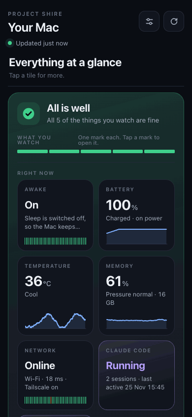
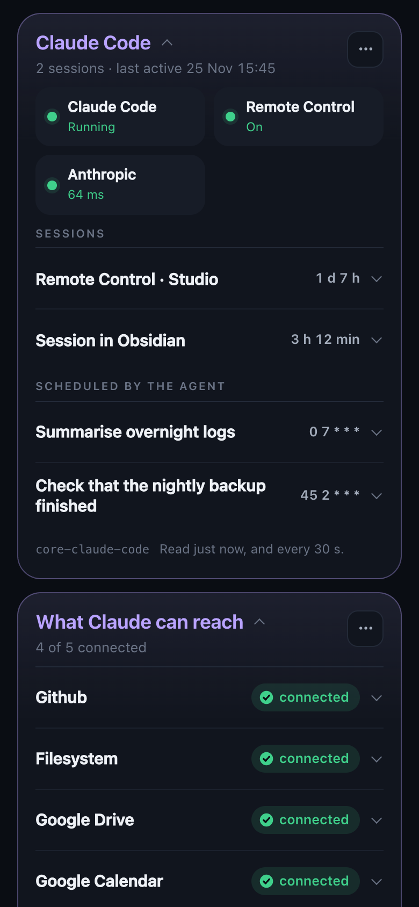
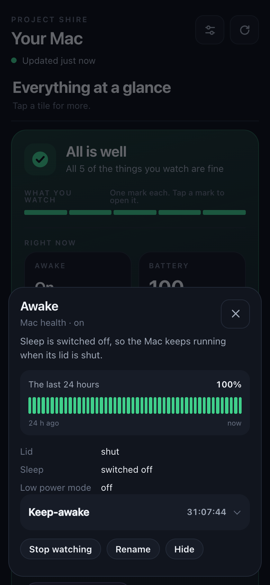

# Project Shire

[](https://github.com/abigailzeke/project-shire/actions/workflows/tests.yml)

An observability platform for laptop servers and power users.

Project Shire monitors a Mac that runs unattended and reports its state on a mobile-first status page: hardware health, applications, background services, containers and AI agent sessions. Every check is a plugin, so coverage is extended with one YAML file or a script in any language.

> **Status:** v0.2.0. macOS only.

<p align="center">
  
  
  
</p>

<p align="center"><sub>The page at phone size, with sample data.</sub></p>

## What it monitors

Eight core plugins are included. Each can be disabled from the page.

| Plugin | Reports |
|---|---|
| Mac health | sleep state, battery, temperature, memory, processor, storage, network, heaviest processes |
| Running apps | open applications, background applications and third-party helpers |
| Running scripts | scripts and interpreters running outside any application |
| Background services | launchd jobs and crontab entries, running or scheduled |
| Docker | Compose projects and the state of each container |
| Claude Code | sessions, Remote Control, connectivity to Anthropic, scheduled jobs |
| What Claude can reach | MCP servers and connectors, and whether each responds |
| Obsidian | note count and recent changes in a vault; disabled until a vault is configured |

A status summary at the top of the page states whether any watched item needs attention. Items are watched, renamed, hidden and grouped from the page, and selected metrics keep 24 hours of history.

## Installation

Shire requires macOS. Claude Code and Tailscale are optional.

```
brew install abigailzeke/tap/shire
shire start
shire link
```

`shire link` prints the access URL. Open it once on each device, and a cookie keeps the device signed in for one year. On a phone, add the page to the home screen to open it like an app.

To install from source instead, with Python 3.11 or later and Node.js 20.19 or later:

```
git clone https://github.com/abigailzeke/project-shire
cd project-shire
python3 -m venv .venv
.venv/bin/pip install -e .
(cd web && npm ci && npm run build)
```

The command is then `.venv/bin/shire`. macOS protects the Documents, Desktop and Downloads folders: when the clone, or a folder a plugin reads, is inside one of them, macOS asks once whether Python may access it.

| Command | Description |
|---|---|
| `shire start` | Registers Shire with launchd, which keeps it running and restarts it at login. |
| `shire stop` | Stops Shire and removes it from launchd. |
| `shire link` | Prints the access URL, which contains the key. |
| `shire run` | Runs Shire in the foreground. |
| `shire run --once` | Runs every enabled plugin once and prints the result of each. |

`start` and `run` accept `--host` and `--port`. The defaults are all network interfaces and port 5190.

## Access and security

**Tailscale is strongly recommended.** Shire serves plain HTTP, so without an encrypted connection the access key crosses the network in the clear. Through Tailscale, the connection is encrypted, and the page is reachable from any device on the same Tailscale network:

```
shire start --host 127.0.0.1
tailscale serve --bg --tcp=5190 tcp://127.0.0.1:5190
```

The page is then at `http://<tailscale-name>:5190/?key=<key>`, with the key that `shire link` prints. `tailscale serve --tcp=5190 off` removes the forward.

- **Access key.** Every request requires a random key, generated on first run and stored in `~/.config/project-shire/key`, readable only by its owner.
- **Without Tailscale.** Shire listens on all network interfaces, so a device on the same network can open the page with the key. Use this on a trusted network only. If the macOS firewall is enabled, it blocks incoming connections to Python until they are allowed in System Settings, under Network, then Firewall.
- **Write scope.** The API writes display settings only. It cannot add or modify a plugin. The most a key holder can do is enable or disable an existing one.

## Architecture

```
┌───────────────────────────┐
│ browser: the status page  │
└──────┬─────────────▲──────┘
       │  port 5190  │
┌──────▼─────────────┴──────┐
│ the monitored Mac         │
│  server    serves the     │
│            page and API,  │
│            behind a key   │
│  user      user-settings/ │
│  directory plugins/ data/ │
│  scheduler runs each      │
│            plugin on its  │
│            own interval   │
│  plugins   inspect the    │
│            Mac and agents │
└───────────────────────────┘
```

- A **plugin** is a directory with a `plugin.yaml` that defines what to check. The **scheduler** runs each one on its own interval.
- Every result uses the same fields, the **standard format**, so one page renders any plugin.
- All user data is kept in the **user directory**, `~/.config/project-shire` or `SHIRE_HOME`, never in the repository: `plugins/` for user plugins, `user-settings/` for choices made on the page, and `data/` for results, which is safe to delete.

The full design is in the [v0.2 baseline](docs/v0.2-baseline.md).

## Plugins

### Built-in checks

A plugin is one file, such as `~/.config/project-shire/plugins/my-site/plugin.yaml`:

```yaml
name: My site
check: website
url: https://example.com
every: 1m
```

The scheduler detects it within seconds, without a restart.

| Check | Reports | Requires |
|---|---|---|
| `website` | whether a URL responds, and the response time | `url` |
| `program` | whether a matching process is running | `match` |
| `port` | whether a port accepts connections | `port` |
| `file` | the contents of a JSON or text file | `path` |
| `folder` | the file count and the most recent changes | `path` |

The other settings, `every`, `timeout`, `enabled`, `display`, `watch`, `tiles` and `history`, are described in the [baseline](docs/v0.2-baseline.md#plugins).

### Script plugins

For anything the built-in checks do not cover, a plugin runs an executable in any language, kept beside its `plugin.yaml`:

```yaml
name: My disk
check: script
script: check.sh
every: 5m
```

```sh
#!/bin/sh
echo '{"items": [{"key": "disk", "name": "Disk", "value": 71, "unit": "%", "state": "good"}]}'
```

The script must be executable (`chmod +x check.sh`) and print JSON in the standard format. Each item requires a `name` and a `key` that is unique and never changes. `value`, `unit`, `state` (`good`, `warn` or `bad`) and `note` are optional. Output that does not match the format is rejected, and the page shows the reason. The [baseline](docs/v0.2-baseline.md#the-standard-format) lists every field.

A Python script runs with Shire's own interpreter and can use its helper: `from shire import script`, then `script.done(items)`.

### Overriding a core plugin

The directory names of core plugins start with `core-`. To change one, create a directory of the same name in the user directory, with a `plugin.yaml` that contains only the settings to change. For example, `plugins/core-obsidian/plugin.yaml`:

```yaml
path: ~/path/to/vault
enabled: true
```

Do not edit the installed copy of a plugin, because an update replaces it.

## Development

```
.venv/bin/pip install -e ".[dev]"
.venv/bin/pytest
(cd web && npm test)
```

## Roadmap

- **More core plugins:** OpenClaw and other agent runtimes, self-hosted models such as Ollama and LM Studio, and Claude usage limits.
- **Platforms:** Linux, then Windows. A plugin can already name one script for each operating system.
- **Alerts:** notifications when a watched item changes state.
- **Multiple machines** on one page.

## License

[MIT](LICENSE)
